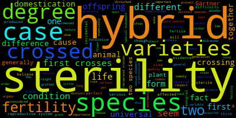

# Assignment 1: Unix and Python
Sahil Ghani

## 1. Number of Subjects

### A. Downloading the files

```bash
cd ~/IntroBiolComp-2026
git pull
mkdir -p ~/IBC_2026_student/Assignments
cp Assignment1/Gesquiere2011_data.csv ~/IBC_2026_student/Assignments/
cp Assignment1/TwelveDaysOfChristmas.txt ~/IBC_2026_student/Assignments/
cd ~/IBC_2026_student/Assignments
```

`git pull` downloads updates to my existing class repository.
The other commands create my assignment folder and copy the data.

### B. Sample counts

Individual 8 was sampled **17 times**.
Individual 22 was sampled **5 times**.

```bash
python count_samples.py Gesquiere2011_data.csv 8
python count_samples.py Gesquiere2011_data.csv 22
```

### C. Counting one individual

`sys.argv` gets the filename and individual ID from the command.
The script skips the header and splits each row into columns.
It checks the first column and adds one for every matching ID.
Finally, it prints the count.

```python
import sys

filename = sys.argv[1]
individual = sys.argv[2]
count = 0

with open(filename) as file:
    next(file)
    for line in file:
        columns = line.split()
        if columns and columns[0] == individual:
            count += 1

print(count)
```

### D. Counting every individual

The dictionary stores a sample count for each ID.
Each data row adds one to that individual's count.
The script sorts the IDs numerically and saves a CSV table.

```python
counts = {}

with open("Gesquiere2011_data.csv") as file:
    next(file)
    for line in file:
        columns = line.split()
        if columns:
            individual = int(columns[0])
            counts[individual] = counts.get(individual, 0) + 1

with open("Num_samples.csv", "w") as output:
    output.write("maleID,Num_samples\n")
    for individual in sorted(counts):
        output.write(f"{individual},{counts[individual]}\n")
```

```bash
python all_samples.py
head Num_samples.csv
```

## 2. Mining The Origin of Species

### A. Downloading the book

```bash
curl -L --fail https://www.gutenberg.org/cache/epub/1228/pg1228.txt -o Origin.txt
```

`curl` downloads the book. `-L` follows redirects,
`--fail` reports HTTP errors, and `-o` names the saved file.

### B. Word counts

```bash
grep -oiw "sterility" Origin.txt | wc -l
grep -oiw "isolation" Origin.txt | wc -l
```

`-i` ignores capitalization, `-w` matches whole words,
and `-o` prints each match separately. `wc -l` counts them.

Sterility: **97** occurrences.

Isolation: **12** occurrences.

### C. Surrounding context

```bash
grep -iw -B 3 -A 3 "sterility" Origin.txt > sterility_context.txt
grep -iw -B 3 -A 3 "isolation" Origin.txt > isolation_context.txt
```

`-B 3` includes three lines before each matching line.
`-A 3` includes three lines after it.
`>` saves the results in separate text files.

### D. Word clouds

```bash
conda install -c conda-forge wordcloud
wordcloud_cli --text sterility_context.txt --imagefile sterility.png
wordcloud_cli --text isolation_context.txt --imagefile isolation.png
```

Conda installs the program. Each command reads a context file
and saves its word cloud as a PNG image.




### E. Interpretation

The clouds summarize words near Darwin's mentions of sterility
and isolation. These topics are relevant to the formation of new
species, so I would question the claim that he did not address
these processes at all. However, word clouds do not explain his
arguments. The surrounding passages must also be read to judge
how fully he explained species formation.

## 3. Twelve Days of Christmas

The days and gifts are stored in lists.
The outer loop chooses each of the twelve days.
The inner loop starts with that day's gift and moves backward
to the first gift. A blank line separates the verses.
The spelling follows the supplied reference file.

```python
days = [
    "First", "Second", "Third", "Fourth",
    "Fifth", "Sixth", "Seventh", "Eigth",
    "Ninth", "Tenth", "Eleventh", "Twelfth"
]

gifts = [
    "A Partridge in a Pear Tree",
    "Two Turtle Doves, and",
    "Three French Hens",
    "Four Colly Birds",
    "Five Gold Rings",
    "Six Geese-a-Laying",
    "Seven Swans-a-Swimming",
    "Eight Maids-a-Milking",
    "Nine Ldaies Dancing",
    "Ten Lords-a-Leaping",
    "Eleven Pipers Piping",
    "Twelve Drummers Drumming"
]

for day in range(12):
    print(f"On the {days[day]} day of Christmas my true love gave to me:")
    for gift in range(day, -1, -1):
        print(gifts[gift])
    if day < 11:
        print()
```

```bash
python christmas.py > christmas_output.txt
diff TwelveDaysOfChristmas.txt christmas_output.txt
```

The first command saves the lyrics.
The second compares them with the reference.
No output from `diff` means the files match.

## 4. Submission

```bash
cd ~/IBC_2026_student
git add Assignments/
git commit -m "Complete Assignment 1 practice"
git push
```

`git add` stages the files, `git commit` records them,
and `git push` uploads the commit to GitHub.
