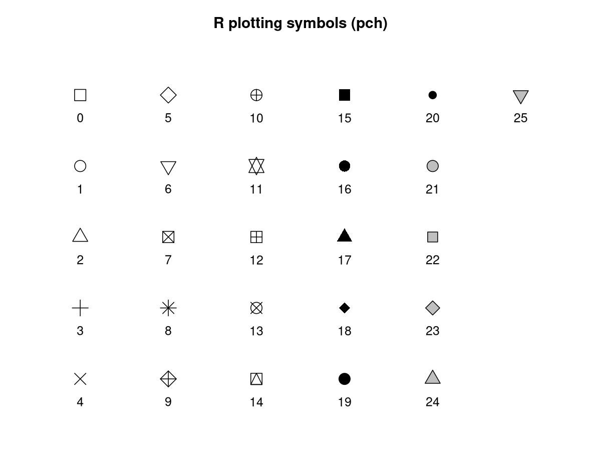
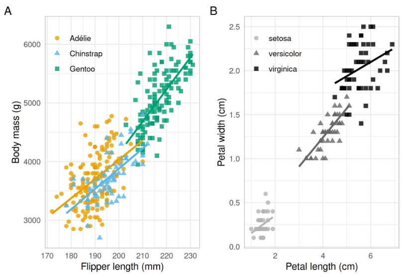
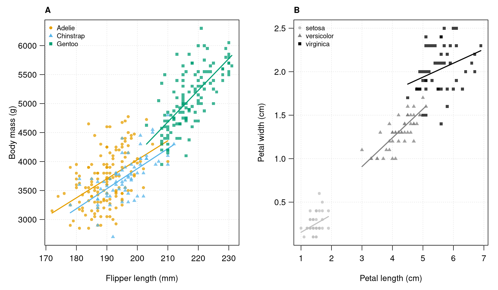

# Week 11: Graphics in R
**Sahil Ghani — BIOL 2214**

## Exercise 1: pch symbols

I reproduced the standard numeric plotting symbols from 0 through 25 and labeled each symbol with its corresponding number. I used a six-column layout without using `expand.grid()`. I used a gray fill for symbols 21–25 so I could distinguish their interiors from their black borders. Numeric symbol 26 is not an additional standard symbol.



### My code and explanation

I created the symbol numbers with `0:25`. I used `rep()` to repeat the horizontal and vertical positions, then kept the first 26 positions. I created an empty plotting area, placed each symbol at its assigned position with `points()`, and added its number with `text()`. I saved the same figure as a PNG and a vector PDF. My complete script is also included as `exercise1.R`.

```r
# I reproduce the numeric pch symbols without expand.grid().
symbols <- 0:25
# I repeat column positions and row positions to arrange six columns.
x <- rep(1:6, each = 5)[seq_along(symbols)]
y <- rep(5:1, times = 6)[seq_along(symbols)]
stopifnot(length(x) == 26, length(y) == 26)
draw_symbols <- function() {
  par(mar = c(1, 1, 3, 1))
  plot(NA, xlim = c(0.5, 6.5), ylim = c(0.4, 5.5),
       axes = FALSE, xlab = "", ylab = "", main = "R plotting symbols (pch)")
  points(x, y, pch = symbols, cex = 2, col = "black", bg = "grey75")
  text(x, y - 0.32, labels = symbols, cex = 1)
}
png("pch_symbols.png", width = 1200, height = 900, res = 150)
draw_symbols()
dev.off()
pdf("pch_symbols.pdf", width = 8, height = 6)
draw_symbols()
dev.off()
```

## Exercise 2: Recreate a scientific figure

### My source and original figure

I chose the two-panel scatterplot from Horst, Hill, and Gorman (2022). It is **Figure 3 in the published PDF, page 248**, and **Figure 4 in the HTML article**. Panel A compares penguin flipper length and body mass. Panel B compares iris petal length and petal width. Both panels show separate fitted lines for each species.

Horst, A. M., Hill, A. P., & Gorman, K. B. (2022). *Palmer Archipelago Penguins Data in the palmerpenguins R Package — An Alternative to Anderson’s Irises.* The R Journal, 14(1), 244–254. https://doi.org/10.32614/RJ-2022-020

Article: https://journal.r-project.org/articles/RJ-2022-020/

Published PDF: https://journal.r-project.org/articles/RJ-2022-020/RJ-2022-020.pdf

Penguin CSV: https://raw.githubusercontent.com/allisonhorst/palmerpenguins/main/inst/extdata/penguins.csv

I used the freely available penguin data distributed by the authors in the palmerpenguins package and the iris dataset supplied with R. The penguin data are available under CC0. The original article is available under CC BY 4.0; I credit its authors here. I cropped the original figure from the published PDF without changing its plotted contents.



### My recreated figure



### My evaluation

I think the original is a good figure because its two panels make the comparison between the datasets easy to follow. I can identify each species using both color and symbol shape. I can also see the measurement units and compare the fitted relationships within species.

I recreated both panels as closely as practical using base R. I retained the variables, units, species groups, color and symbol choices, and separate regression lines. I used a similar light grid and partially transparent points so overlapping observations remain visible. My version differs in fonts, panel proportions, and other minor styling details; I do not claim it is an exact visual duplicate.

In my recreation, I see that penguins with longer flippers tend to have greater body mass. Gentoo penguins generally have longer flippers and greater body mass than the other two species, while Adélie and Chinstrap overlap substantially. I also see a positive relationship between iris petal length and width, with setosa clearly separated from the other species. I interpret these patterns as associations, not evidence that one measurement causes the other.

### My code and explanation

I read the penguin CSV and excluded only the two observations missing a required plotted measurement, leaving 342 penguins. I kept all 150 iris observations. I assigned consistent colors and symbols to the species and placed the two panels side by side. Within each panel, I plotted the observations and fitted a separate linear regression for each species. I restricted each fitted line to that species’ observed horizontal range so I did not extrapolate beyond its data. I added legends and axis labels and saved PNG and PDF versions. My complete script is also included as `exercise2.R`.

```r
# I read the freely available penguin data supplied with this folder.
penguins <- read.csv("penguins.csv", na.strings = c("", "NA"))
# I retain every penguin with both measurements needed for this figure.
penguins <- penguins[complete.cases(penguins[c("flipper_length_mm", "body_mass_g")]), ]
data(iris)
groups <- c("Adelie", "Chinstrap", "Gentoo")
colors <- c("#E69F00", "#56B4E9", "#009E73")
shapes <- c(16, 17, 15)
stopifnot(nrow(penguins) == 342, nrow(iris) == 150)
draw_panel <- function(x, y, group, levels, cols, pchs, xlab, ylab, panel) {
  plot(x, y, type = "n", xlab = xlab, ylab = ylab, las = 1)
  grid(col = "grey90")
  for (i in seq_along(levels)) {
    keep <- group == levels[i]
    points(x[keep], y[keep], col = adjustcolor(cols[i], alpha.f = 0.75),
           pch = pchs[i], cex = 0.8)
    # I fit each species separately and restrict its line to its observed x range.
    fit <- lm(y[keep] ~ x[keep])
    xx <- range(x[keep])
    lines(xx, coef(fit)[1] + coef(fit)[2] * xx, col = cols[i], lwd = 2)
  }
  legend("topleft", legend = levels, col = cols, pch = pchs, bty = "n", cex = 0.8)
  mtext(panel, side = 3, adj = 0, line = 0.5, font = 2)
}
draw_figure <- function() {
  par(mfrow = c(1, 2), mar = c(4.5, 4.5, 2, 1), mgp = c(2.8, 0.8, 0))
  draw_panel(penguins$flipper_length_mm, penguins$body_mass_g,
             penguins$species, groups, colors, shapes,
             "Flipper length (mm)", "Body mass (g)", "A")
  draw_panel(iris$Petal.Length, iris$Petal.Width,
             as.character(iris$Species), levels(iris$Species),
             c("grey75", "grey50", "black"), shapes,
             "Petal length (cm)", "Petal width (cm)", "B")
}
png("recreated_figure.png", width = 1800, height = 1050, res = 180)
draw_figure()
dev.off()
pdf("recreated_figure.pdf", width = 10, height = 5.83)
draw_figure()
dev.off()
```
