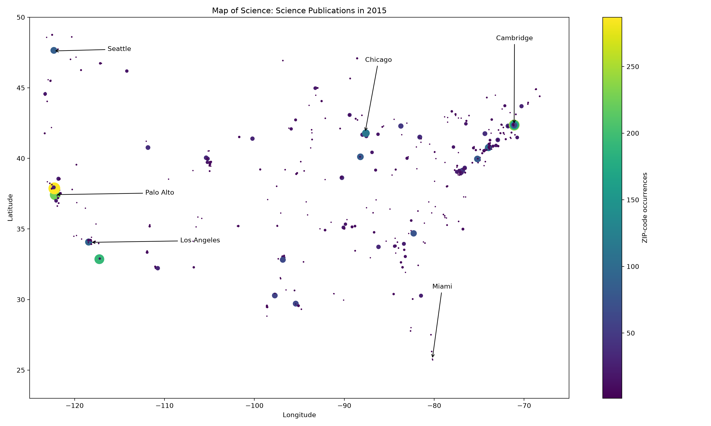

# Week 7 Practical

## Regular Expression Exercises

### 1. Finding a digit
Pattern: `\d`

Output: `"2"`

This matches one digit. The first digit in "it takes 2 to tango" is 2.

### 2. Matching text ending with a digit
Pattern: `\w*\s\d.*\d`

Output: `"take 2 grams of H2"`

This matches word characters, whitespace, a digit, any number of
characters, and another digit. The match ends at the 2 in H2O.
The final O is not included.

### 3. Finding a word between spaces
Pattern: `\s\w*\s`

Output: `" upon "`

This matches whitespace, zero or more word characters, and whitespace.
The first match is "upon", including its surrounding spaces.

### 4. Finding a short word between spaces
Pattern: `\s\w{1,3}\s`

Output: `" a "`

This matches one to three word characters surrounded by whitespace.
"upon" has four letters, so the first match is "a".
The surrounding spaces are included.

### 5. Finding the final word
Pattern: `\s\w*$`

Output: `" time"`

This matches whitespace followed by word characters at the end of
the string. It includes the space before "time".

## GC Content Exercise

The script gc_content.py uses regular expressions to count G and C
bases and divides their total by the sequence length.

For AAGTCGTGAGCA, six of the twelve bases are G or C.

GC proportion = 6 / 12 = 0.5.
GC percentage = 50%.

## Accession Number Exercise

These patterns follow the formats given in the assignment.
Use re.fullmatch() to match the entire accession.

Protein: three letters followed by five digits.

Pattern: `[A-Za-z]{3}[0-9]{5}`
Example: ABC12345

Whole genome: four letters followed by two version digits and
six to eight additional digits.

Pattern: `[A-Za-z]{4}[0-9]{2}[0-9]{6,8}`
Example: ABCD01000001

Nucleotide: one letter followed by five digits, or two letters
followed by six digits.

Pattern: `(?:[A-Za-z][0-9]{5}|[A-Za-z]{2}[0-9]{6})`
Examples: A12345 and AB123456

## Final Problem: A Map of Science

### 1. Extract ZIP codes
Use regular expressions to extract five-digit ZIP-code candidates
from pubmed_results.txt, including the first five digits of ZIP+4
codes. Match these candidates against the coordinate table.

### 2. Create the required lists
Use the csv module to read the ZIP, LAT, and LNG columns.

Create four corresponding lists:
- zip_code: unique ZIP codes, stored as strings to preserve leading zeros.
- zip_long: longitude for each ZIP code.
- zip_lat: latitude for each ZIP code.
- zip_count: number of occurrences of each ZIP code in the text.

These counts describe ZIP-code occurrences, which are not necessarily
the number of distinct papers from each location.

### 3. Visualize the results
Plot longitude against latitude, using ZIP-code counts for marker
size and color. Use the continental US limits provided in the assignment.

The calculated results are saved in zip_summary.csv.

## Results

The analysis found 502 unique ZIP codes and 5,272 ZIP-code
occurrences matching the coordinate table.

The map is saved as map_of_science.png, and the ZIP codes,
coordinates, and counts are saved as zip_summary.csv.
